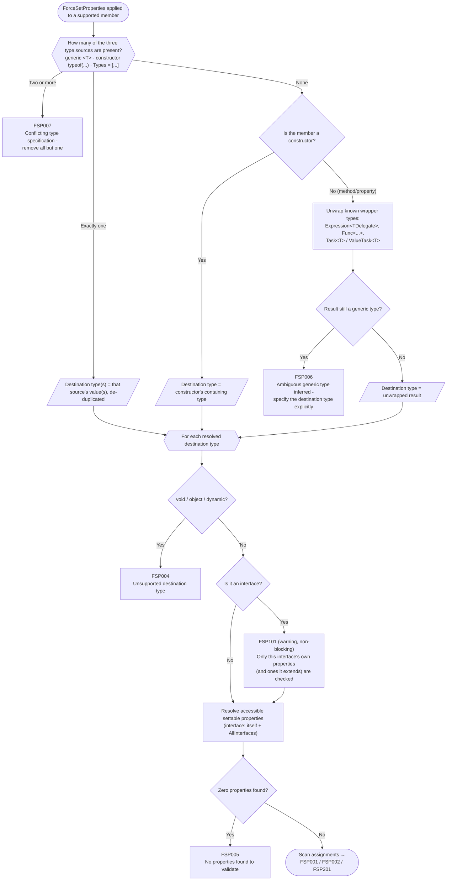
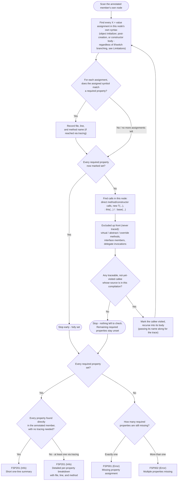

# ForceSetProperties

Compile-time enforcement that **all settable properties must be initialized** when constructing a type.

`ForceSetProperties` is a Roslyn analyzer–backed attribute that prevents missing property assignments when creating DTOs, mapping models, or writing factory methods. If a new property is added later, **all annotated constructors, methods, and expressions will fail compilation until updated**.

---

## ✨ Features

* ✅ Compile-time enforcement (no runtime cost)
* ✅ Works on **constructors**, **methods**, and **expressions** (class-level support is planned — see [Limitations](#limitations))
* ✅ Supports **generic type override**: `ForceSetProperties<T>`
* ✅ Detects **object initializer** assignments
* ✅ Detects **return expressions**
* ✅ Detects **out parameter assignments**
* ✅ Detects **lambda / expression-bodied factories**
* ✅ Fails when new properties are added but not mapped

---

## 📦 Installation

Install via NuGet:

```bash
dotnet add package ForceSetProperties.Analyzers
```

or via Package Manager:

```powershell
Install-Package ForceSetProperties.Analyzers
```

---

## 🚀 Basic Usage

### Apply to a class — not yet supported

Placing `[ForceSetProperties]` directly on a class is **not implemented yet**. Rather than silently doing nothing, this raises a compile error so it can't be mistaken for working:

```csharp
[ForceSetProperties] // ❌ FSP003: not yet supported on a class
public class DtoModel
{
    public string Name { get; set; }
    public DateTime CreatedAt { get; set; }
    public DateTime UpdatedAt { get; set; }
}
```

Until class-level support lands, annotate the individual constructors, methods, or expressions that build the type instead — see the sections below.

---

## Apply to a constructor

```csharp
public class DtoModel
{
    public DtoModel()
    {
    }

    [ForceSetProperties]
    public DtoModel(DbModel db)
    {
        Name = db.Name;
        CreatedAt = db.CreatedAt;
        UpdatedAt = db.UpdatedAt;
    }

    public string Name { get; set; }
    public DateTime CreatedAt { get; set; }
    public DateTime UpdatedAt { get; set; }
}
```

If a property is added later:

```csharp
public string Description { get; set; }
```

The constructor will now **fail compilation** until updated.

---

## Apply to a method

```csharp
[ForceSetProperties]
public DtoModel FromFunction(string name, DateTime createdAt, DateTime updatedAt)
{
    return new DtoModel
    {
        Name = name,
        CreatedAt = createdAt,
        UpdatedAt = updatedAt
    };
}
```

This ensures the returned `DtoModel` always has **every property initialized**.

---

## Specify target type explicitly

Useful when:

* return type is different
* using `out` parameters
* multiple DTOs created

```csharp
[ForceSetProperties<DtoModel>]
public DbModel SomeFunction(DbModel source, out DtoModel dto)
{
    dto = new DtoModel
    {
        Name = source.Name,
        CreatedAt = source.CreatedAt,
        UpdatedAt = source.UpdatedAt
    };

    return source;
}
```

---

## Apply to expressions / lambdas

```csharp
[ForceSetProperties]
public static Expression<Func<DbModel, DtoModel>> FromExpression => db => new DtoModel
{
    Name = db.Name,
    CreatedAt = db.CreatedAt,
    UpdatedAt = db.UpdatedAt
};
```

This is especially useful for:

* EF projections
* LINQ Select mappings
* AutoMapper replacements
* Expression factories

---

## Which properties are required

A property is required when the code being validated can actually see **and** set it — not only when the property is `public`. The analyzer checks this the same way the C# compiler does, using normal accessibility rules (`public`, `internal`, `protected`, `private`) from the point of view of the annotated constructor, method, or expression.

```csharp
public class DtoModel
{
    public string Name { get; private set; }

    [ForceSetProperties]
    public static DtoModel CreateInstance(string name)
    {
        return new DtoModel { Name = name };
    }
}
```

`Name` has a `private set`, but `CreateInstance` lives inside `DtoModel`, so it has access — `Name` is still required. The same `private set` property would **not** be required from a `[ForceSetProperties]` method in a different class, since that code has no access to the setter.

This means a property is skipped only when the code being validated genuinely cannot set it — not just because the setter happens to be non-public.

Properties **inherited from a base class** are required too, not only ones declared directly on the destination type:

```csharp
public class BaseModel
{
    public string Id { get; set; }
}

public class DtoModel : BaseModel
{
    public string Name { get; set; }

    [ForceSetProperties]
    public static DtoModel Create(string id, string name)
    {
        return new DtoModel { Id = id, Name = name };
    }
}
```

`Id` is declared on `BaseModel`, but it's still required when validating `DtoModel` — leaving it unset reports `FSP001` the same as any other missing property. An `override`d property is only required once (on the derived type), not once per declaration in the base class chain.

When the destination type is an **interface**, the same idea applies to every interface it extends — and an assignment made on the concrete instance being constructed counts as satisfying the interface property it implements, even though they're technically different symbols:

```csharp
public interface IHasName
{
    string Name { get; set; }
}

public interface IDto : IHasName
{
    int Age { get; set; }
}

public class DtoModel : IDto
{
    public string Name { get; set; }
    public int Age { get; set; }
}

[ForceSetProperties<IDto>]
public DtoModel Create()
{
    return new DtoModel { Name = "x", Age = 1 }; // satisfies both IDto.Age and IHasName.Name
}
```

See [What triggers a warning](#destination-type-is-an-interface) for the caveat that comes with validating against an interface at all.

---

## What counts as "set"

The analyzer considers a property initialized when:

### Object initializer

```csharp
new DtoModel
{
    Name = x,
    CreatedAt = y,
    UpdatedAt = z
}
```

Target-typed `new(...)` (no type name before the parentheses) is recognized the same way as `new DtoModel(...)` - both resolve to the same constructor:

```csharp
DtoModel Create() => new()
{
    Name = x,
    CreatedAt = y,
    UpdatedAt = z
};
```

### Assignment after creation

```csharp
var dto = new DtoModel();

dto.Name = x;
dto.CreatedAt = y;
dto.UpdatedAt = z;
```

### Constructor assignments

```csharp
Name = db.Name;
CreatedAt = db.CreatedAt;
UpdatedAt = db.UpdatedAt;
```

---

## Tracing into called methods and constructors

If a `[ForceSetProperties]` method doesn't build the target type directly but delegates to another **normal, non-virtual method or constructor**, the analyzer follows that call and checks the callee for the same "what counts as set" patterns.

```csharp
[ForceSetProperties]
public DtoModel Create(DbModel db)
{
    return Map(db);
}

private static DtoModel Map(DbModel db)
{
    return new DtoModel
    {
        Name = db.Name,
        CreatedAt = db.CreatedAt,
        UpdatedAt = db.UpdatedAt
    };
}
```

This is valid — `Map` sets every property, so `Create` is considered compliant even though it never constructs `DtoModel` itself.

This works because the callee is part of the same compilation, so the analyzer can resolve exactly which method or constructor runs and inspect its body at compile time.

This also follows constructor chaining (`: this(...)` / `: base(...)`):

```csharp
public class DtoModel
{
    public string Name { get; set; }
    public string Id { get; set; }

    public DtoModel()
    {
        Id = Guid.NewGuid().ToString();
    }

    [ForceSetProperties]
    public DtoModel(string name) : this()
    {
        Name = name;
    }
}
```

`Id` is never assigned directly inside the `(string name)` constructor, but the analyzer follows the `: this()` call into the parameterless constructor and finds it there.

---

## Records

Records and record structs are supported, including two patterns that don't look like ordinary
assignments at all.

### Positional construction

A positional record's primary constructor has no body for the analyzer to inspect - the
parameter-to-property mapping is synthesized by the compiler. Each constructor argument is matched
to the correspondingly-named property directly, the same way records already name them:

```csharp
public record Person(string Name, int Age);

[ForceSetProperties]
public Person Create(string name, int age)
{
    return new Person(name, age);
}
```

This also works through constructor chaining, the same as any other constructor:

```csharp
public record Person(string Name, int Age)
{
    public Person(string name) : this(name, 0)
    {
    }
}
```

Any property that isn't part of the positional parameter list is still validated normally - adding
one without also setting it (via a constructor argument or an object initializer) still fails.

### Annotating the primary constructor directly

`method:` is the syntactically correct way to attach an attribute to a record's primary
constructor itself, rather than to the record type:

```csharp
[method: ForceSetProperties]
public record Person(string Name, int Age)
{
    public Person() : this(default, default) { }
}
```

This validates the primary constructor exactly like any other constructor - `Name` and `Age` are
both set here via the `: this(default, default)` chain into it. Without `method:`, the attribute
targets the record type itself instead (same as a plain class) and is rejected as unsupported - see
[Apply to a class](#apply-to-a-class--not-yet-supported).

### `with` expressions

A `with` expression copies every property from its source instance except the ones it explicitly
overrides. Properties left out of the `with { ... }` block are treated as set - via the copy - not
missing:

```csharp
public record Person
{
    public string Name { get; init; }
    public int Age { get; init; }
}

[ForceSetProperties]
public Person Rename(Person existing, string name)
{
    return existing with { Name = name }; // Age is carried over from existing, not missing
}
```

---

## What triggers a compile error

### Missing property

```
error FSP001: Property 'UpdatedAt' must be initialized on 'AuditLog' when using ForceSetProperties
```

### Multiple missing properties

```
error FSP002: The following properties on 'AuditLog' must be initialized:
 - CreatedAt
 - UpdatedAt
```

### Unsupported attribute placement

```
error FSP003: ForceSetProperties can only be applied to constructors, methods, or properties; this target is not yet supported
```

Raised whenever `[ForceSetProperties]` is placed anywhere else — most notably on a class (see above), but also fields, events, or any other declaration. This exists so an unsupported usage fails loudly instead of being silently skipped.

This also covers a method with **no body at all** — an interface method signature with no default implementation, or an `abstract` method declaration:

```csharp
public interface IFactory
{
    [ForceSetProperties]
    Dto Create(); // no body - nothing here to check yet
}
```

There's nothing here to have initialized a property in, so this isn't "a property was forgotten" — annotate the real implementation (the type implementing `IFactory`, or the `override`) instead, once it exists. A default interface method implementation or an `override`, both of which do have a body, validate normally and aren't affected by this.

### Unsupported destination type

```
error FSP004: ForceSetProperties cannot validate 'void'; void, object, and dynamic are not supported destination types
```

Raised when the resolved destination type is `void`, `object`, or `dynamic` — there are no strongly-typed properties to check, so validating it would either be meaningless or trivially "pass" with nothing checked. This applies no matter how the type was determined: return type inference, `ForceSetProperties<T>`, or an explicit `Types = [...]`.

### No properties found to validate

```
error FSP005: ForceSetProperties found no assignable properties on 'EmptyDto' to validate; check that this is the intended destination type
```

Raised when the destination type resolves successfully (it's not `void`/`object`/`dynamic`) but has zero properties the annotated code can actually see and set — most often because the wrong type was inferred or specified. Without this check, a destination type with no assignable properties would trivially "pass" validation with nothing checked, which is easy to mistake for a real guarantee.

### Ambiguous inferred generic destination type

```
error FSP006: ForceSetProperties inferred 'List<DatabaseModel>' as the destination type, but it's generic and its properties may not be what you intend to validate; specify the destination type explicitly, for example ForceSetProperties(typeof(YourType)) or ForceSetProperties<T>, to confirm 'List<DatabaseModel>' is really what you mean
```

Raised when return type (or property type) inference — with no explicit `Types = [...]`, `typeof(...)` constructor argument, or `ForceSetProperties<T>` — lands on a generic type such as `List<T>`, `Dictionary<TKey, TValue>`, or a custom `Result<T>`/`Maybe<T>` wrapper. "Validate the container" and "validate what it wraps" are both plausible readings of `[ForceSetProperties]` on a method returning a bare generic type, and there's no safe default to pick silently — so this is rejected rather than silently validating the wrapper's own (usually irrelevant) properties.

`Task<T>` and `ValueTask<T>` are the one exception: they're unwrapped to `T` *before* this check ever runs (see [Return type inference](#return-type-inference-default)), since there's no legitimate scenario where validating `Task<T>` itself — rather than what it resolves to — was the intent.

Explicitly stating the destination type is never blocked by this, no matter how generic it is — `[ForceSetProperties(typeof(List<DatabaseModel>))]` or `[ForceSetProperties<List<DatabaseModel>>]` validates `List<DatabaseModel>` exactly as asked.

### Conflicting destination type specification

```
error FSP007: ForceSetProperties has more than one destination type specification on the same member (generic argument, constructor argument, and/or Types property); these don't merge - remove all but one
```

Raised when more than one of the three explicit ways to specify a destination type — the generic `ForceSetProperties<T>` argument, a `typeof(...)` constructor argument, and the named `Types = [...]` property — are used together on the same attribute application:

```csharp
public class TypeA { public string Name { get; set; } }
public class TypeB { public string Name { get; set; } }

[ForceSetProperties<TypeA>(Types = new[] { typeof(TypeB) })]
public static object Create()
{
    return new TypeB { Name = "x" };
}
```

Using two (or three) of these together doesn't mean "validate both types" — they don't merge — so this is rejected rather than silently picking one and discarding the rest. Using exactly one of the three, on its own, is unaffected and validates normally, no matter which one.

---

## What triggers a warning

### Destination type is an interface

```
warning FSP101: ForceSetProperties is validating against the interface 'IDto'; only properties declared on 'IDto' (or an interface it extends) are checked, so properties on the concrete type actually being constructed that aren't part of 'IDto' are not verified. Consider specifying the concrete destination type instead.
```

Raised whenever the destination type — however it was determined — is an interface:

```csharp
public interface IDto
{
    string Name { get; set; }
}

public class DtoModel : IDto
{
    public string Name { get; set; }
}

[ForceSetProperties<IDto>]
public DtoModel Create()
{
    return new DtoModel { Name = "x" };
}
```

`IDto`'s own properties (and every property on any interface `IDto` extends) are still fully validated — setting `Name` on the concrete `DtoModel` instance satisfies `IDto.Name`, and leaving it unset still reports `FSP001` — but `DtoModel` could have other properties that aren't part of `IDto` at all, and those are never checked no matter what. This warning is reported unconditionally alongside whatever else the interface's own properties produce (`FSP001`/`FSP002`/`FSP201`), as a reminder that validating against an interface is inherently narrower than validating the concrete type actually being constructed — specify the concrete type instead for full coverage.

---

## Validation feedback

Besides compile errors, the analyzer also reports an informational diagnostic when a `[ForceSetProperties]` target passes validation.

When every property was set directly, it's a short one-line summary naming the type and its properties:

```
info FSP201: ForceSetProperties validated DtoModel: Name, CreatedAt, UpdatedAt
```

When at least one property was only found by [tracing into a called method or constructor](#tracing-into-called-methods-and-constructors), it switches to a full breakdown showing where each property was actually set — file path relative to the project, plus the method name whenever that came from a trace:

```
info FSP201: Type checked: DtoModel
Name: TestModels\DtoModel.cs line 46
CreatedAt: TestModels\DtoModel.cs line 47
UpdatedAt: TestModels\DtoModel.cs line 23 (via .ctor)
```

If a property ends up being set in more than one place, only the first location found is shown.

This is reported at `Info` severity on the `[ForceSetProperties]` attribute, so it stays out of the way in normal build output while still being visible as a subtle IDE squiggle and in the tooltip / "Messages" tab of the Error List — a quick way to confirm a mapping is complete without opening and re-reading the whole method.

---

## Attribute Targets

### Class — not yet supported

Raises `FSP003`. See [Apply to a class](#apply-to-a-class--not-yet-supported) above.

---

### Constructor

```csharp
[ForceSetProperties]
public DtoModel(DbModel db)
```

---

### Record primary constructor

```csharp
[method: ForceSetProperties]
public record Person(string Name, int Age);
```

See [Annotating the primary constructor directly](#annotating-the-primary-constructor-directly) above.

---

### Method

```csharp
[ForceSetProperties]
public DtoModel Create()
```

---

### Expression / Property

```csharp
[ForceSetProperties]
public static Expression<Func<X,Y>> Map => ...
```

---

### Generic Type Override

```csharp
[ForceSetProperties<DtoModel>]
```

---

## Supported Scenarios

- ✔ DTO mapping
- ✔ EF projections
- ✔ Factory methods
- ✔ Constructors
- ✔ Static creators
- ✔ Lambda expressions
- ✔ Expression trees
- ✔ Out parameter assignment
- ✔ Multi-return methods
- ✔ Positional records / record structs
- ✔ `with`-expression updates
- ✔ Interface destination types (with a warning - see [What triggers a warning](#destination-type-is-an-interface))
- ✔ `[method: ForceSetProperties]` on a record primary constructor

---
## Specifying Target Types

`ForceSetProperties` can determine the target type in multiple ways depending on how the attribute is used.

The analyzer supports:

1. Return type inference  
2. Generic attribute `ForceSetProperties<T>`  
3. Explicit `Types` property `ForceSetProperties(Types = [...])`  
4. Multiple target types  

---

### Return type inference (default)

When no type is specified, the analyzer uses the **return type** of the method or expression.

```csharp
[ForceSetProperties]
public DtoModel Create()
{
    return new DtoModel
    {
        Name = "Test",
        CreatedAt = DateTime.UtcNow,
        UpdatedAt = DateTime.UtcNow
    };
}
```

An `async` method's `Task<T>`/`ValueTask<T>` return type is unwrapped automatically, so inference lands on `T`, not the task wrapper itself:

```csharp
[ForceSetProperties]
public async Task<DtoModel> CreateAsync()
{
    await Task.Yield();
    return new DtoModel { Name = "Test" }; // validates DtoModel, not Task<DtoModel>
}
```

Any *other* generic type reached only through inference — `List<T>`, `Dictionary<TKey, TValue>`, a custom `Result<T>` wrapper, and so on — is ambiguous (validate the container, or what it wraps?) and raises [`FSP006`](#ambiguous-inferred-generic-destination-type) instead of silently validating the wrapper. Specify the destination type explicitly (`typeof(...)` or `ForceSetProperties<T>`) to validate a generic type on purpose.

### Generic attribute

Use the generic version when the return type is different or cannot be inferred.

```csharp
[ForceSetProperties<DtoModel>]
public DbModel Create(DbModel source, out DtoModel dto)
{
    dto = new DtoModel
    {
        Name = source.Name,
        CreatedAt = source.CreatedAt,
        UpdatedAt = source.UpdatedAt
    };

    return source;
}
```

### Using Types property

The attribute also supports explicitly specifying the type using the Types property.

```csharp
[ForceSetProperties(Types = [typeof(DtoModel)])]
public DbModel Create(DbModel source, out DtoModel dto)
{
    dto = new DtoModel
    {
        Name = source.Name,
        CreatedAt = source.CreatedAt,
        UpdatedAt = source.UpdatedAt
    };

    return source;
}
```
### Multiple types

You can enforce multiple DTOs within the same method.

```csharp
[ForceSetProperties(Types = [typeof(UserDto), typeof(RoleDto)])]
public void Map(User user, Role role, out UserDto userDto, out RoleDto roleDto)
{
    userDto = new UserDto
    {
        Id = user.Id,
        Name = user.Name
    };

    roleDto = new RoleDto
    {
        Id = role.Id,
        Name = role.Name
    };
}
```
All specified types must have every publicly assignable property initialized. Listing the same type more than once in `Types = [...]` doesn't produce a duplicate diagnostic - repeated entries are de-duplicated, so each distinct type is only ever validated (and reported on) once.

### All supported forms

```csharp
[ForceSetProperties]

[ForceSetProperties<DtoModel>]

[ForceSetProperties(typeof(DtoModel))]

[ForceSetProperties(Types = [typeof(DtoModel)])]

[ForceSetProperties(Types = [typeof(Dto1), typeof(Dto2)])]
```

All forms are treated equivalently by the analyzer **as long as only one of them is used at a
time** - see the flowchart below for what happens when more than one is combined.

---

## How the destination type is selected

The flowchart below covers the full decision process behind "Specifying Target Types" above,
including every case that results in a compile error.



Note this diagram is scoped to *type selection* only - it starts from an attribute already on a
supported constructor/method/property (`FSP003`, for placement on anything else, is covered
separately under ["What triggers a compile error"](#what-triggers-a-compile-error)), and ends once
a destination type is confirmed valid; what happens when scanning that type's properties for actual
assignments (`FSP001`/`FSP002`/`FSP201`) is covered in its own sections above.

---

## Non-Goals

The analyzer intentionally does NOT:

* Require setters to be public
* Require constructor parameters
* Enforce nullability
* Enforce order
* Enforce nested object initialization

This analyzer **only ensures all properties settable from the validated code — public, internal, protected, or private — are assigned**.

---

## Limitations

Tracing into called methods and constructors has a few intentional boundaries:

* **Interfaces, virtual, and overridden methods are not followed.** If the call could resolve to more than one implementation at runtime, the analyzer ignores it entirely — assignments inside are neither counted nor required.
* **Delegates and lambdas stored in variables are not followed.** Only direct calls to ordinary methods and constructors are traced.
* **Conditional branches (`if`/`else`, `switch`) are not analyzed for exhaustiveness.** A property set inside an `if` — but not its `else`, or in only one `switch` case — still counts as "set". The analyzer does not try to prove every code path sets a property; the goal is to catch a property that was **completely forgotten**, not to enforce branch-complete initialization.
* **Methods without available source (e.g. from a referenced assembly) are not followed.** Only methods and constructors that are part of the current compilation can be inspected.

These limitations are deliberate — the feature exists to catch forgotten property assignments when a new property is added, not to perform full control-flow or dataflow analysis.

---

## How property scanning works

Once a destination type is confirmed (see the flowchart above) and it has at least one required
property (`FSP005` otherwise), this is how the analyzer decides whether each one was actually set,
and which diagnostic comes out the other end - covering "Which properties are required", "What
counts as set", "Tracing into called methods and constructors", and the limitations above as one
end-to-end process.



A few notes that don't fit neatly into the diagram itself:

- **This stops as early as possible.** The moment every required property has a recorded location,
  scanning ends immediately - it does not keep exploring the call graph "just in case," and it does
  not care about proving every code path sets a property (see Limitations).
- **"Find every `X = value` assignment" only recognizes assignment-expression syntax.** Positional
  record/record struct construction (`new Person(name, age)`) and properties left unlisted in a
  `with { ... }` expression (which are copied from the source instance, not assigned) aren't
  assignment syntax at all, so neither is currently recognized as "set" - tracked as
  [`Known-issues.md`](Known-issues.md) #2 and #3 respectively.
- **Recursion is unbounded except by the visited-set and the compilation's own call graph** - there's
  no depth limit, only "don't visit the same callee twice" and "stop once nothing traceable is left."

---

## Why use this instead of `required`

`required` enforces initialization at **call site**:

```csharp
new DtoModel { ... }
```

`ForceSetProperties` enforces initialization at **factory definition**:

```csharp
DtoModel Create()
```

This makes it ideal for:

- DTO mapping layers
- Conversion constructors
- Projection expressions
- Factory patterns
- Preventing silent DTO drift

---

## Example: Safe DTO evolution

Initial DTO:

```csharp
public class DtoModel
{
    [ForceSetProperties]
    public DtoModel(string name)
    {
        Name = name;
    }

    public string Name { get; set; }
}
```

Later:

```csharp
public DateTime CreatedAt { get; set; }
```

All mappings now fail compilation until updated.

This prevents:

* silent nulls
* incomplete mappings
* runtime bugs
* forgotten properties

---

## Analyzer Rules

Error diagnostics use the `FSP0xx` range; warnings use `FSP1xx`; informational diagnostics use `FSP2xx` - so severity is visible from the ID alone. The full rule table below is also what shows up under a referencing project's Dependencies > Analyzers node in Solution Explorer, the same way it does for `Microsoft.CodeAnalysis.NetAnalyzers` and other `DiagnosticAnalyzer`-based packages. IDs are ordered by how likely you are to hit them - `FSP001` is the common case, higher numbers are progressively more of an edge case.

### Errors (`FSP0xx`)

| ID     | Description                      |
| ------ | --------------------------------- |
| FSP001 | Missing property assignment       |
| FSP002 | Multiple properties missing       |
| FSP003 | Unsupported attribute target       |
| FSP004 | Unsupported destination type       |
| FSP005 | No properties found to validate    |
| FSP006 | Ambiguous inferred generic destination type |
| FSP007 | Conflicting destination type specification |

### Warnings (`FSP1xx`)

| ID     | Description                        |
| ------ | ----------------------------------- |
| FSP101 | Destination type is an interface    |

### Informational (`FSP2xx`)

| ID     | Description               |
| ------ | -------------------------- |
| FSP201 | All properties validated   |

---

## Best Practices

### Use on DTOs

Class-level support isn't available yet, so annotate every constructor and factory method that builds the DTO instead (see below).

### Use on mapping constructors

```csharp
[ForceSetProperties]
public UserDto(User user)
```

### Use on expression projections

```csharp
[ForceSetProperties]
Expression<Func<User, UserDto>>
```

---

## Performance

- Compile-time only
- Zero runtime overhead
- No reflection
- No allocations
- No IL changes

---

## License

MIT
